### 👋 Olá, eu sou o Luiz!

- 🗄️ DBA na **NTT DATA**: Oracle (RAC, Exadata, Data Guard, GoldenGate), SQL Server, PostgreSQL e MySQL
- 🎧 Comecei no suporte N1 e migrei para banco de dados
- 📊 Já trabalhei com BI, dashboards e ETL
- 🎓 Estudando **Ciência de Dados**
- 🤖 Criando automações com IA, n8n e Python
- 📍 São Paulo, SP

 

### 🛠️ Tecnologias

  

### 🚀 Projeto em destaque

**monitor-db-ia**: detecta queries lentas no PostgreSQL e no Oracle, diagnostica com IA local, abre chamado no Jira
e, com a aprovação do DBA, aplica o índice e mede o ganho (até **97%** no lab). Previsão de degradação no Databricks.
Público em breve.

### 📈 GitHub Stats

### 😂 Piada do dia

